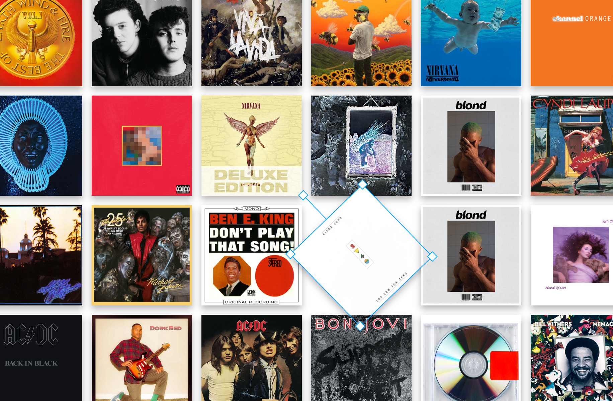

# Playlist Canvas

Turn the album covers in a Spotify playlist into an editable, downloadable collage. Choose a playlist, arrange its artwork on a canvas, and export the composition as a PNG.

[Open the application](https://playlist-canvas.fuerst.one) · [Author and other projects](https://fuerst.one)



## Features

- Browse and search Spotify playlists and load their tracks and album artwork.
- Start with a grid or randomized arrangement, then move, resize, and rotate individual covers.
- Adjust artwork size, spacing, background color, and canvas dimensions; phone and desktop presets are included.
- Work in fullscreen and download the collage as a PNG.

## Technical overview

Built with Next.js 14, React 18, TypeScript, Tailwind CSS, Radix UI components, TanStack Query, and Konva through React Konva.

```text
Spotify authorization -> server-side code exchange -> browser token storage
Spotify playlists/tracks -> TanStack Query -> React context -> Konva canvas -> PNG
```

- The login route starts Spotify's authorization-code flow. Server functions exchange and refresh tokens using the server-side client secret.
- Access and refresh tokens are stored in browser localStorage. Playlist requests run in the browser through the Spotify fetch wrapper.
- `CollageCreatorContext` manages loaded images, selection, transforms, canvas settings, fullscreen state, and export.
- Canvas rendering and image export happen in the browser. There is no application database or server-side collage renderer.

## Run locally

Requirements: Node.js, Yarn (the repository includes `yarn.lock`), and a Spotify developer application with access to the Web API.

Create `.env.local` in the repository root:

```dotenv
SPOTIFY_CLIENT_ID=your_spotify_client_id
SPOTIFY_CLIENT_SECRET=your_spotify_client_secret
NEXTAUTH_URL=http://127.0.0.1:6860
```

`NEXTAUTH_URL` supplies the application origin used to construct the callback; the authentication flow is implemented by the repository's own routes and server functions. Keep the client secret server-side and out of version control.

Register this exact redirect URI in your Spotify application:

```text
http://127.0.0.1:6860/api/auth/callback
```

Spotify requires HTTPS outside loopback development and an explicit loopback address rather than `localhost`. See [Spotify redirect URI requirements](https://developer.spotify.com/documentation/web-api/concepts/redirect_uri).

```sh
yarn install --frozen-lockfile
yarn dev
```

Open [127.0.0.1:6860](http://127.0.0.1:6860). The development port is configured in `package.json`.

## Spotify access and project scope

The hosted application includes a **Request Access** link. A Spotify application in development mode requires users to be allowlisted; available endpoints and quotas depend on Spotify's current application policy. See [Spotify quota modes](https://developer.spotify.com/documentation/web-api/concepts/quota-modes). A reachable landing page does not establish that every visitor can authenticate or load playlists.

This is a personal creative tool. The repository implements playlist browsing, canvas editing, and PNG export; it does not provide cloud-saved compositions or collaborative editing. Account-specific API access and the authenticated workflow need to be checked with an authorized Spotify account.

## Source map

| Path                            | Responsibility                                      |
| ------------------------------- | --------------------------------------------------- |
| `src/app/api/auth`              | Login route and callback page                       |
| `src/server`                    | Spotify token exchange and refresh                  |
| `src/lib`                       | Spotify requests, token storage, and query provider |
| `src/components/Playlist`       | Playlist browsing and track selection               |
| `src/components/CollageCreator` | Canvas state, rendering, controls, and export       |

## Build and checks

```sh
yarn lint
yarn build
yarn start
```

`yarn start` serves the production build and uses Next.js's default port unless `PORT` is set. Keep the configured origin and Spotify redirect URI in sync with the port you use. The repository does not currently define an automated test script.
